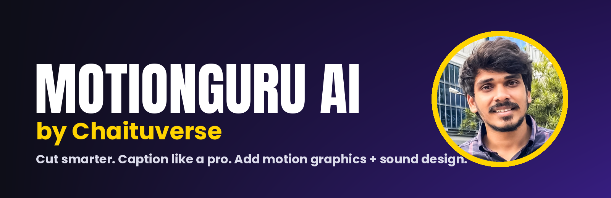

<p align="center"></p>

# MotionGuru AI
**by Chaituverse.** Drop a talking-head video into Claude Code (or run the CLI) and get an edit that asks before it cuts, with pro captions, motion graphics, your face on the lower third, and layered sound design, rendered in one pass.

Built on the open-source [claude-reel-effects](https://github.com/adamgodigital/claude-reel-effects) engine (kept in `engine/`, MIT). See [ANALYSIS.md](ANALYSIS.md) for what we changed and why.

## What's new vs the original
| | |
|---|---|
| **Cut here or not?** | `cuts propose` finds silences, fillers (um, uh) and retakes, shows the words around each, opens a review page where you hear every moment and tap Cut/Keep. Nothing is removed until you approve. |
| **Pro captions** | 5 styles (`hormozi`, `karaoke`, `pill`, `minimal`, `neon`), keyword colours, Reels-safe position, Telugu/Hindi ready. Output is an editable `.ass`. |
| **Motion graphics** | `punch`, `shake`, `flash`, `glitch`, spring-pop `title`, `lower_third` and `watermark` with your face, `stat` cards, cinematic grades, vignette, grain. |
| **Sound design** | 11 synthesised SFX, auto-placed (riser before the hit), premium-pack slot, -14 LUFS, music ducking. |
| **One pass** | cuts, effects, captions, audio in a single ffmpeg graph: one encode, GPU when available. |
| **55 face-tracking effects** | still there: `motionguru engine orbit in.mp4 out.mp4 ...` |

## Install
```bash
git clone https://github.com/Chaitukarpurapu/MotionGuru-AI-by-Chaituverse-Claude ~/.claude/skills/motionguru
cd ~/.claude/skills/motionguru && pip install -r requirements.txt
```
Needs `ffmpeg` (Mac `brew install ffmpeg`, Windows `winget install ffmpeg`). Then in Claude Code: `/motionguru full edit` and drag your video in.

## CLI
```bash
python -m motionguru cuts propose reel.mp4 --lang te          # suggestions + review.html, nothing cut
python -m motionguru cuts apply   reel.mp4 --approve 1,3-5    # or: safe | all | ask (answer y/n in terminal)
python -m motionguru captions reel.mp4 --style karaoke --keywords "AI|free"
python -m motionguru edit reel.mp4 --plan plans/example.plan.json --approve safe          # everything, one pass
python -m motionguru edit reel.mp4 --plan my.plan.json --approve safe --still 5.5         # one check frame
python -m motionguru brand --name "Chaitu" --handle "@yourhandle" --accent "#FFD400"
python -m motionguru engine spotlight reel.mp4 out.mp4 --text "FREE"                      # face-tracking pass
```
Effect times in a plan are on the **final (post-cut)** timeline.

## Your face
`assets/avatar.png` is cropped from your photo and shows in `lower_third` and `watermark`. Swap it with `brand --avatar path.png`.

## Premium SFX
Put licensed `.wav/.mp3` in `sfx_pack/` named by role (`whoosh_01.wav`, `riser_02.mp3` ...). They replace the synth sounds and are git-ignored. See `sfx_pack/README.md`.

## Telugu / Hindi
`--lang te` or `--lang hi`, `WHISPER_MODEL=medium`, and install *Noto Sans Telugu / Devanagari* so captions don't show boxes.

## Test
`pip install pytest && pytest` (needs ffmpeg). CI is in `.github/workflows/ci.yml`.

## Licence
MIT. Original copyright notices for Vibha Ramprakash and Adam Digital are preserved in `LICENSE`, `NOTICE.md` and `engine/`. Brand logos are trademarks of their owners.
